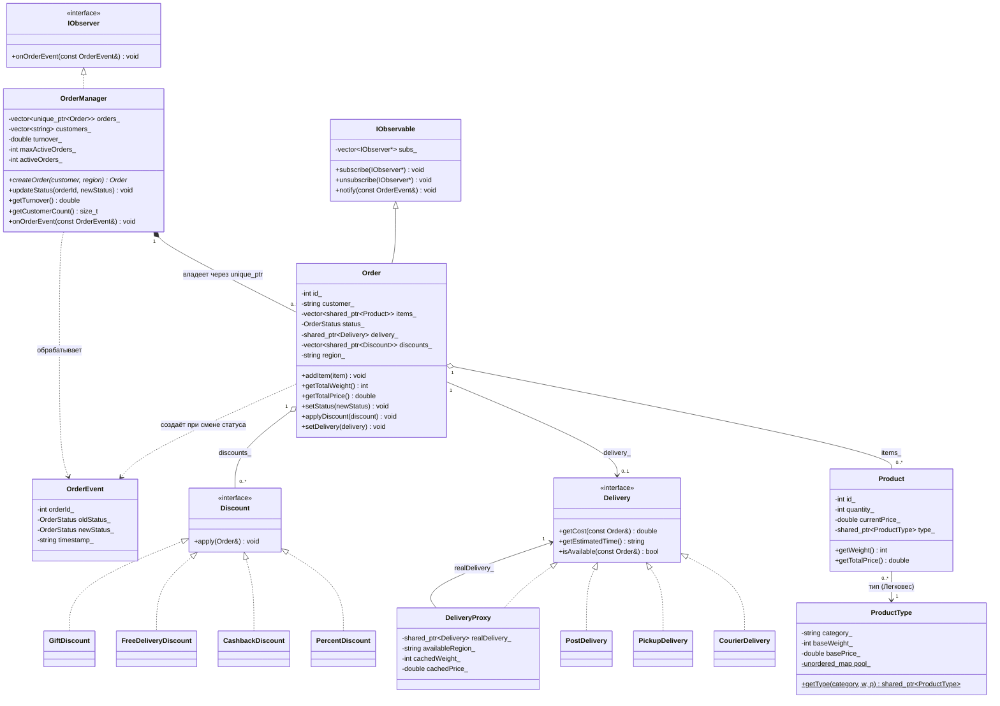
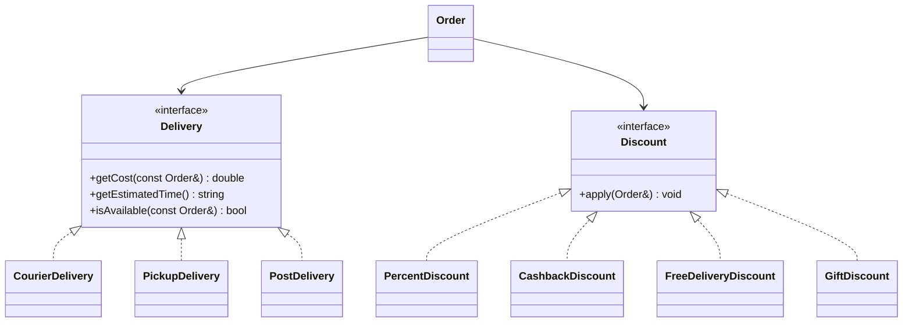
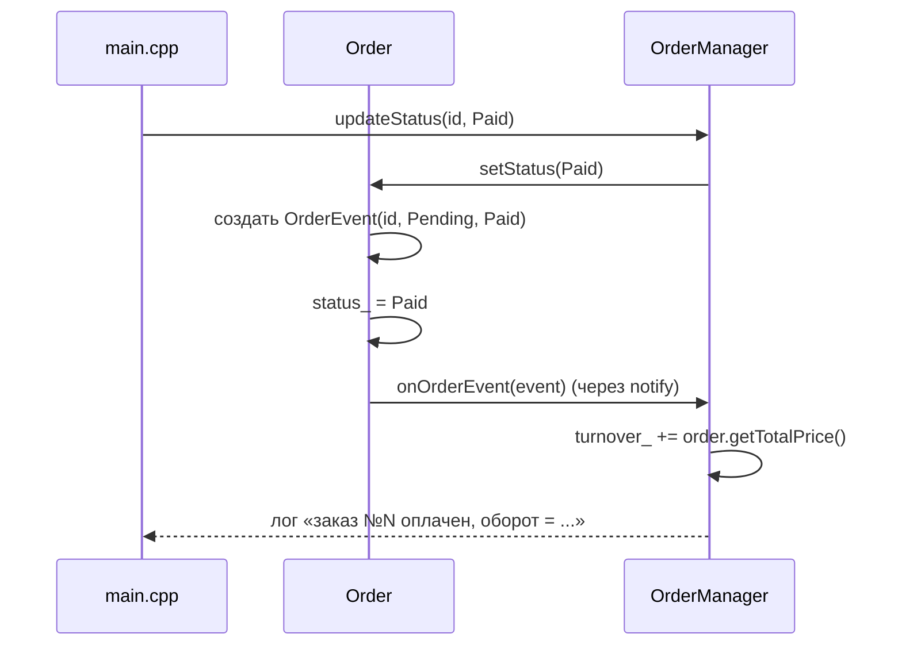

# Система управления заказами и доставкой на C++

Лабораторная работа по ООП: класс `OrderManager` с учётом заказов, статусов, лимитов и оборота; способы доставки и акции как стратегии; паттерны «Наблюдатель», «Прокси», «Стратегия», «Легковес»; взаимодействие через перегруженные операторы.


## Содержание

1. [Цель и задача](#цель-и-задача)
2. [Структура проекта](#структура-проекта)
3. [Сборка и запуск](#сборка-и-запуск)
4. [Архитектура и UML](#архитектура-и-uml)
5. [Паттерн «Стратегия»](#паттерн-стратегия)
6. [Паттерн «Наблюдатель»](#паттерн-наблюдатель)
7. [Паттерн «Прокси»](#паттерн-прокси)
8. [Паттерн «Легковес»](#паттерн-легковес)
9. [Перегрузка операторов](#перегрузка-операторов)
10. [Правило пяти](#правило-пяти)
11. [Демонстрационные сценарии](#демонстрационные-сценарии)
12. [Тестирование](#тестирование)
13. [Соответствие критериям оценки](#соответствие-критериям-оценки)
14. [Выводы](#выводы)

---

## Цель и задача

**Цель.** Реализовать систему управления заказами, способами доставки и акциями, используя паттерны «Наблюдатель», «Прокси», «Стратегия», а также перегрузку операторов для взаимодействия объектов.

**Что реализовано.**

| Компонент | Описание |
|---|---|
| `OrderManager` | Создание заказов, отслеживание статусов, лимит активных заказов на клиента (не более 5), учёт оборота и уникальных клиентов; подписан на события заказов |
| `Order` | Заказ: товары, статус (`OrderStatus`), доставка, скидки, регион; издатель событий о смене статуса |
| `Product` / `ProductType` | Товар и его разделяемый тип со статическим пулом (паттерн «Легковес») |
| Доставки | 3 способа: `CourierDelivery` (500 руб., 1–2 дня, до 20 кг), `PickupDelivery` (бесплатно, 1–3 дня), `PostDelivery` (200 руб., 5–10 дней, до 10 кг) |
| `DeliveryProxy` | Заместитель доставки: проверка веса и региона, логирование, кеширование стоимости |
| Акции | 4 скидки: `PercentDiscount` (−10%), `CashbackDiscount` (5% на бонусный счёт), `FreeDeliveryDiscount`, `GiftDiscount` (бесплатный товар) |
| Операторы | `order + discount`, `delivery << order`, `std::ostream << order` |
| `main.cpp` | Меню из пяти демонстрационных сценариев |

---

## Структура проекта

```text
.
├── .vscode/
│   └── tasks.json                                   задача сборки для VS Code (Ctrl+Shift+B)
├── Discount/            Discount.h                  интерфейс скидки
├── Discounts/           *.h / .cpp                  четыре конкретные скидки
├── Delivery/            Delivery.h                  интерфейс способа доставки
├── Deliveries/          *.h / .cpp                  три конкретные доставки
├── DeliveryProxy/       DeliveryProxy.h / .cpp      заместитель доставки
├── IObserver/           IObserver.h, IObservable.h / .cpp   интерфейсы Наблюдателя
├── Order/               Order.h / .cpp              заказ, операторы +, <<, << (ostream)
├── OrderEvent/          OrderEvent.h / .cpp         событие смены статуса
├── OrderManager/        OrderManager.h / .cpp       менеджер заказов
├── OrderStatus/         OrderStatus.h / .cpp        enum статусов и statusToString
├── Product/             Product.h / .cpp            товар
├── ProductType/         ProductType.h / .cpp        тип товара со статическим пулом
├── .gitignore                                       исключает собранные *.exe из репозитория
├── main.cpp                                         меню демонстрационных сценариев
├── run.bat                                          запуск программы в Windows с кодировкой UTF-8
└── README.md                                        этот отчёт
```

Каждый класс / интерфейс лежит в своей папке парой `.h` / `.cpp`. Заголовки защищены `#pragma once`, `using namespace std` нигде не используется.

---

## Сборка и запуск

Нужен компилятор с поддержкой C++17 (проверено на g++ 15 из MSYS2). Собранной программы в репозитории нет (`*.exe` исключены через `.gitignore`), поэтому сначала проект нужно собрать, а потом запустить.

### Шаг 1. Сборка

**VS Code в Windows.** В `.vscode/tasks.json` настроена задача сборки: она компилирует все `.cpp` проекта с нужными флагами `-I` и кладёт `order_manager.exe` в корень проекта. Откройте папку проекта целиком и нажмите `Ctrl+Shift+B`. Путь к компилятору указан для MSYS2: `C:\msys64\ucrt64\bin\g++.exe`. Если g++ установлен в другом месте, измените поле `command` в `tasks.json`.

**Командная строка.** Из корня проекта:

```bash
g++ -std=c++17 -Wall -Wextra -IDiscount -IDiscounts -IDelivery -IDeliveries \
    -IDeliveryProxy -IIObserver -IOrder -IOrderEvent -IOrderManager \
    -IOrderStatus -IProduct -IProductType \
    main.cpp Discounts/*.cpp Deliveries/*.cpp DeliveryProxy/DeliveryProxy.cpp \
    IObserver/IObservable.cpp Order/Order.cpp OrderEvent/OrderEvent.cpp \
    OrderManager/OrderManager.cpp OrderStatus/OrderStatus.cpp \
    Product/Product.cpp ProductType/ProductType.cpp -o order_manager
```

В Windows результат называется `order_manager.exe`.

### Шаг 2. Запуск

**Windows.** Дважды щёлкните по `run.bat`. Файл включает кодировку UTF-8 (иначе русский текст в консоли превращается в набор символов), запускает `order_manager.exe` и по завершении держит окно открытым:

```bat
@echo off
chcp 65001 > nul
order_manager.exe
pause
```

Запускать `order_manager.exe` напрямую двойным щелчком не рекомендуется: без `chcp 65001` текст будет нечитаемым.

**Linux / macOS.** `./order_manager`.

После запуска появляется главное меню:

```text
==============================
   ДЕМОНСТРАЦИОННЫЕ СЦЕНАРИИ
==============================
   1. Создание заказа через OrderManager, добавление товаров, применение процентной скидки через order + discount
   2. Выбор способа доставки через delivery << order, проверка доступности через DeliveryProxy
   3. Смена статуса заказа, уведомление OrderManager через Observer, обновление оборота
   4. Применение нескольких скидок к одному заказу, проверка итоговой цены
   5. Отмена заказа, освобождение лимита активных заказов, обновление статистики клиентов
------------------------------
   0. Выход
==============================
```

---

## Архитектура и UML

### Общая диаграмма



> В диаграмме опущены `const`, ссылки и указатели в параметрах, чтобы не перегружать запись. Знак `$` — статические члены.

### Ключевые проектные решения

| Решение | Как реализовано | Зачем |
|---|---|---|
| Владение заказами | `std::vector<std::unique_ptr<Order>>` в `OrderManager`, наружу отдаётся невладеющий `Order*` | Единственный владелец, утечек нет, клиентский код не может удалить заказ |
| Владение товарами и типами | `std::shared_ptr` | Тип товара разделяется всеми товарами категории (Легковес), подарок переживает функцию, создавшую его |
| Уникальный `id` заказа | статический счётчик `Order::nextId_`, присваивается в конструкторе | Идентификатор не зависит от вызывающего кода |
| Передача параметров | константные ссылки `const T&` везде, где возможно; enum и числа — по значению | Нет лишних копий |
| Регион заказа | поле `Order::region_`, задаётся в конструкторе | Прокси проверяет регион до делегирования |
| Подписчики | `std::vector<IObserver*>` — сырые невладеющие указатели | Издатель не владеет подписчиком и не продлевает ему жизнь |

---

## Паттерн «Стратегия»

**Идея.** Алгоритмы расчёта стоимости доставки и применения скидок вынесены в отдельные классы за общими интерфейсами `Delivery` и `Discount`. Заказ работает с интерфейсами и не знает о конкретных алгоритмах — новый способ доставки или новая акция добавляются без изменения кода заказа.

### Роли в паттерне

| Роль | Доставка | Скидки |
|---|---|---|
| Интерфейс стратегии | `Delivery` (`getCost`, `getEstimatedTime`, `isAvailable`) | `Discount` (`apply`) |
| Конкретные стратегии | `CourierDelivery`, `PickupDelivery`, `PostDelivery` | `PercentDiscount`, `CashbackDiscount`, `FreeDeliveryDiscount`, `GiftDiscount` |
| Контекст | `Order` (поле `delivery_`) | `Order` (поле `discounts_`) |

### Диаграмма



### Реализация

Интерфейс доставки (`Delivery.h`) — обратите внимание на виртуальный деструктор и наследование `enable_shared_from_this` (нужно для оператора `<<`, см. [Перегрузка операторов](#перегрузка-операторов)):

```cpp
class Delivery : public std::enable_shared_from_this<Delivery>{
    public:
    virtual ~Delivery() = default;
    virtual double getCost(const Order&) const = 0;
    virtual std::string getEstimatedTime() const = 0;
    virtual bool isAvailable(const Order&) const = 0;
};
```

Конкретная стратегия (`CourierDelivery.cpp`):

```cpp
double CourierDelivery::getCost(const Order&) const {
    return 500.0;
}

bool CourierDelivery::isAvailable(const Order& order) const {
    return order.getTotalWeight() <= 20;
}
```

Выбор стратегии — позднее связывание через таблицу виртуальных функций (vtable): `order + percentDiscount` вызывает `apply` именно того класса, объект которого передан, хотя оператор работает со ссылкой на базовый `Discount`.

---

## Паттерн «Наблюдатель»

**Идея.** `OrderManager` должен реагировать на смену статусов заказов (пересчитывать оборот при оплате, освобождать слот лимита при доставке или отмене), но заказ не должен знать о менеджере. Заказ — издатель, менеджер — подписчик, связь устанавливается через интерфейсы.

### Роли в паттерне

| Роль | Класс |
|---|---|
| Издатель (Observable) | `IObservable` — хранит `std::vector<IObserver*>`, реализует `subscribe` / `unsubscribe` / `notify` |
| Подписчик (Observer) | `IObserver`, чисто виртуальный `onOrderEvent(const OrderEvent&)` |
| Конкретный издатель | `Order` (наследует `IObservable`, зовёт `notify` из `setStatus`) |
| Конкретный подписчик | `OrderManager` (реализует `onOrderEvent`) |
| Событие | `OrderEvent` — иммутабельный класс: `orderId_`, `oldStatus_`, `newStatus_`, `timestamp_` |

### Реализация

Уведомление при смене статуса (`Order.cpp`) — событие собирается до присваивания, чтобы захватить старый статус; подписчики вызываются уже после смены:

```cpp
void Order::setStatus(const OrderStatus& newStatus){
    if(newStatus == status_){
        return;
    }
    OrderEvent event(id_, status_, newStatus);
    status_ = newStatus;
    this->notify(event);
}
```

Подписка происходит при создании заказа (`OrderManager.cpp`):

```cpp
auto order = std::make_unique<Order>(customer, OrderStatus::Pending, region);
order->subscribe(this);
Order* raw = order.get();
orders_.push_back(std::move(order));
```

Реакция подписчика: при `Paid` оборот увеличивается на сумму заказа, при `Cancelled` и `Delivered` счётчик активных заказов уменьшается (заказ перестаёт занимать слот лимита).

### Как проходит событие



Подписчики хранятся сырыми указателями (`IObserver*`), а не `shared_ptr`: издатель не владеет подписчиком. Правило работы — подписчик отписывается до своего уничтожения (в проекте `OrderManager` живёт дольше любого заказа, поэтому это гарантировано).

---

## Паттерн «Прокси»

**Идея.** `DeliveryProxy` реализует тот же интерфейс `Delivery`, что и реальные способы доставки, поэтому заказ не отличает заместителя от оригинала. Прокси добавляет контроль и сервис: предварительную проверку веса и региона, логирование вызовов и кеширование результата.

### Роли в паттерне

| Роль | Класс |
|---|---|
| Интерфейс субъекта | `Delivery` |
| Реальный субъект | `CourierDelivery`, `PickupDelivery`, `PostDelivery` |
| Заместитель | `DeliveryProxy` (поле `std::shared_ptr<Delivery> realDelivery_`) |
| Клиент | `Order` (принимает любую `Delivery`, включая прокси) |

### Реализация

Проверки до делегирования (`DeliveryProxy.cpp`):

```cpp
bool DeliveryProxy::isAvailable(const Order& order) const{
    if(order.getTotalWeight() >= kgMaxDeliveryWeight){  // общий лимит сервиса 1500 кг
        // лог «отказано - превышен максимальный вес»
        return false;
    }
    if(order.getRegion() != availableRegion_){           // прокси обслуживает свой регион
        // лог «отказано - недоступный регион доставки»
        return false;
    }
    bool result = realDelivery_->isAvailable(order);     // делегирование
    // лог результата
    return result;
}
```

Кеширование стоимости — `getCost` константный, поэтому поля кеша объявлены `mutable` (кеш не меняет логическое состояние объекта). Ключом кеша служит вес заказа: изменился вес — кеш протух:

```cpp
double DeliveryProxy::getCost(const Order& order) const{
    int input = order.getTotalWeight();
    if(input == cachedWeight_){
        return cachedPrice_;                    // cache hit
    }
    double out = realDelivery_->getCost(order); // cache miss
    cachedWeight_ = input;
    cachedPrice_ = out;
    return out;
}
```

Корректность такого кеша держится на инварианте «стоимость зависит только от веса» (в текущих доставках она вообще константа). Появление тарифа «за километр» потребует пересмотра ключа кеша — см. [Известные ограничения](#выводы).

---

## Паттерн «Легковес»

**Идея.** Товары одной категории делят неизменяемые данные типа (категория, базовый вес, базовая цена). Вместо копии этих данных в каждом товаре все ссылаются на один общий объект `ProductType` из статического пула.

### Реализация

Пул и фабрика «найди или создай» (`ProductType.cpp`). Конструктор приватный, поэтому объекты создаются только через пул:

```cpp
std::shared_ptr<ProductType> ProductType::getType(const std::string& category, int w, double p){
    auto type = pool_.find(category);
    if(type == pool_.end()){
        std::shared_ptr<ProductType> newType(new ProductType(category, w, p));
        pool_.emplace(category, newType);
        return newType;
    }
    return type->second;
}
```

Тонкость: `std::make_shared` несовместим с приватным конструктором (он вызывает конструктор из служебного кода вне класса), поэтому используется прямой `new` внутри статического метода класса — там доступ к приватному конструктору есть.

«Легковес» работает и для подарка: `GiftDiscount` создаёт бесплатный товар через тот же `getType("бонусный подарок", 0, 0.0)` — нулевые вес и цена не влияют ни на стоимость заказа, ни на квоту веса доставки.

---

## Перегрузка операторов

Три оператора, все — свободные функции (объявлены в `Order.h`, реализованы в `Order.cpp`):

| Оператор | Сигнатура | Что делает |
|---|---|---|
| `order + discount` | `Order& operator+(Order&, const Discount&)` | применяет скидку к заказу через `discount.apply(order)` |
| `delivery << order` | `Order& operator<<(Delivery&, Order&)` | назначает заказу способ доставки через `order.setDelivery(...)` |
| `os << order` | `std::ostream& operator<<(std::ostream&, const Order&)` | выводит id, клиента, статус, сумму, вес и регион заказа |

Два технических момента:

- **`const` в интерфейсе скидки.** Оператор `+` получает `const Discount&`, поэтому `apply` объявлен константным методом: скидка меняет заказ, но не саму себя.
- **`enable_shared_from_this` в доставке.** `setDelivery` принимает `shared_ptr<Delivery>`, а оператор `<<` — ссылку `Delivery&`. Безопасный `shared_ptr` из ссылки даёт идиома `enable_shared_from_this`: оператор вызывает `delivery.shared_from_this()`. Ограничение идиомы: объект обязан жить под управлением `shared_ptr` (в сценариях доставки создаются через `make_shared`), иначе `shared_from_this` бросит `std::bad_weak_ptr`.

Оператор вывода пишет в переданный поток `os` (а не жёстко в `std::cout`) и возвращает его — это позволяет выводить в файл и строить цепочки `cout << o1 << o2`. Методом класса такой оператор сделать нельзя: слева от `<<` стоит поток, а не заказ.

---

## Правило пяти

В проекте все ресурсы управляются умными указателями, поэтому большинству классов достаточно компиляторных специальных функций (правило нуля). Для двух классов политика задана явно — запретом:

| Класс | Политика | Почему |
|---|---|---|
| `Order` | копирование и перемещение запрещены (`= delete`) | Заказ — сущность с уникальным `id_`: копия дублировала бы id и поверхностно разделила товары через `shared_ptr` |
| `OrderManager` | конструктор по умолчанию `= default`, копирование запрещено (`= delete`) | Владеет заказами через `unique_ptr`; явный запрет превращает случайное копирование в ошибку компиляции |

Важная тонкость, обнаруженная при рефакторинге: объявление любого конструктора (в том числе удалённого) подавляет неявный конструктор по умолчанию, поэтому в `OrderManager` он возвращён явно — `OrderManager() = default;`.

Иммутабельный `OrderEvent` копируется компиляторным конструктором — у класса-«конверта с данными» нет ресурсов и нет смысла ограничивать копирование.

---

## Демонстрационные сценарии

Все сценарии запускаются из главного меню. Между запусками программа очищает экран, после результата ждёт нажатия Enter. Ниже приведён реальный вывод программы, служебные строки меню опущены.

### Сценарий 1. Создание заказа, добавление товаров, скидка через `order + discount`

Заказ создаётся через `OrderManager`, добавляются два товара, применяется процентная скидка.

```text
600267 (цена до скидки)
540240 (цена после скидки в 10%)
```

Что демонстрируется: `createOrder`, `addItem`, оператор `+`. Арифметика: `1 × 267 + 20 × 30000 = 600267`, после скидки `600267 × 0.9 = 540240.3` (вывод без дробной части — особенность печати `double`).

### Сценарий 2. Выбор доставки через `delivery << order`, проверка через `DeliveryProxy`

Заказ на 15 кг: почта (до 10 кг) отказывает, курьер (до 20 кг) соглашается. Выбор — интерактивный, после отказа предлагается другой способ.

```text
Id: 1 клиент: Сёма Бакин статус: Pending сумма: 6000 вес: 15 регион: Irkutsk

Выберите способ доставки:
  1. Курьер (500 руб., 1-2 дня, до 20 кг)
  2. Самовывоз (бесплатно, 1-3 дня, без ограничений)
  3. Почта (200 руб., 5-10 дней, до 10 кг)
Ваш выбор: 3
[DeliveryProxy] isAvailable: запрос для заказа, вес = 15
[DeliveryProxy] isAvailable: делегировано, способ доставки подтвердил: недоступна
Этот способ недоступен для вашего заказа, выберите другой

Ваш выбор: 1
[DeliveryProxy] isAvailable: запрос для заказа, вес = 15
[DeliveryProxy] isAvailable: делегировано, способ доставки подтвердил: доступна

Доставка назначена. Ориентировочное время: 1-2 дня
Id: 1 клиент: Сёма Бакин статус: Pending сумма: 6500 вес: 15 регион: Irkutsk
```

Что демонстрируется: прокси-фильтрация, делегирование реальному способу, оператор `<<` для назначения доставки, пересчёт цены с учётом стоимости доставки. При повторных запросах стоимости видны строки `cache hit` / `cache miss` кеша прокси.

### Сценарий 3. Смена статуса, уведомление `OrderManager` через Наблюдателя

Заказ на 3000 руб. оплачивается, затем доставляется.

```text
Оборот до оплаты: 0

[OrderManager] INFO: заказ №1 оплачен, оборот = 3000

Оборот после оплаты: 3000
[OrderManager] INFO: заказ доставлен, активных заказов: 0
```

Что демонстрируется: паттерн «Наблюдатель». Код сценария вызывает только `updateStatus` — оборот и счётчик активных заказов менеджер обновляет сам, реагируя на события заказа.

### Сценарий 4. Несколько скидок на один заказ

Заказ на 10000 руб. с курьерской доставкой; применяются все четыре акции подряд.

```text
Товары + доставка: 10500
После скидки 10%: 9450
После бесплатной доставки: 8950
После кешбэка (цена та же, бонусы начислены): 8950
Товаров в заказе после подарка: 2
Итоговая цена: 8950
```

Что демонстрируется: цепочка стратегий скидок через `order + discount`. Процентная скидка берётся от полного чека (включая доставку) — осознанное решение. Кешбэк меняет бонусный счёт, а не цену; подарок добавляет товар нулевой стоимости и веса.

### Сценарий 5. Отмена заказа и освобождение лимита

У клиента создаётся 5 активных заказов (лимит), шестой отклоняется, после отмены одного создание снова возможно.

```text
Создано 5 активных заказов. Клиентов: 1
Лимит сработал: У этого клиента уже 5 активных заказов
[OrderManager] INFO: заказ отменён, активных заказов: 4
После отмены заказ создан: id = 6
```

Что демонстрируется: лимит активных заказов на клиента, исключение `std::runtime_error` при превышении, освобождение слота через событие `Cancelled`, учёт уникальных клиентов.

---

## Тестирование

Проверка проводилась прогоном всех сценариев из меню, в том числе с некорректным вводом (буквы вместо числа, несуществующие пункты). Проект собирается с `-Wall -Wextra` без предупреждений.

| Область | Что проверено | Результат |
|---|---|---|
| Легковес | повторный `getType` возвращает тот же объект пула, нулевые вес и цена подарка не влияют на итоги заказа | пройдено |
| Скидки | процентная (арифметика сходится), кешбэк на бонусный счёт, бесплатная доставка, подарок | пройдено |
| Доставки и прокси | отказ по весу (почта, 15 кг), отказ по региону и лимиту 1500 кг, делегирование при успехе, кеш (hit/miss в логе) | пройдено |
| Наблюдатель | оборот при `Paid`, освобождение слота при `Cancelled` и `Delivered`, мусорные события «статус не изменился» отфильтрованы | пройдено |
| Лимиты | 5 активных заказов — шестой отклонён исключением, после отмены создание снова возможно | пройдено |
| Операторы | `+` применяет скидку, `<<` назначает доставку, вывод заказа в поток | пройдено |
| Устойчивость демо | сценарии не падают при запуске в любом порядке (id заказов берутся из объектов, а не литералов) | пройдено |
| Ввод | нечисловой ввод и несуществующие пункты меню не роняют программу | пройдено |

---

## Соответствие критериям оценки

| № | Критерий | Баллы | Где реализовано |
|---|---|---|---|
| 1 | Класс `OrderManager`: создание заказов, отслеживание статусов, ограничения, учёт оборота и клиентов | 10 | `OrderManager/OrderManager.h`, `.cpp` |
| 2 | Способы доставки (3, общий интерфейс, расчёт стоимости и проверка доступности) | 10 | `Delivery/`, `Deliveries/` |
| 3 | Акции (4, общий интерфейс) | 10 | `Discount/`, `Discounts/` |
| 4 | Взаимодействие через перегрузку операторов (3 операции) | 5 | `Order/Order.cpp` (`operator+`, два `operator<<`) |
| 5 | Паттерн «Наблюдатель» в управлении заказами | 20 | `IObserver/`, `Order::setStatus`, `OrderManager::onOrderEvent` |
| 6 | Паттерн «Прокси» для алгоритма доставки | 25 | `DeliveryProxy/` |
| 7 | Паттерн «Стратегия» для алгоритмов скидок | 20 | `Discount/`, `Discounts/` |

---

## Выводы

- Реализована система управления заказами с четырьмя паттернами: «Стратегия» (доставки и скидки), «Наблюдатель» (менеджер следит за статусами), «Прокси» (контроль, логирование и кеш доставки), «Легковес» (разделяемые типы товаров).
- Паттерн «Наблюдатель» развязал заказ и менеджер: `Order` не знает, кто слушает его события, поэтому новые подписчики (логгер, уведомления клиенту) добавятся без изменения существующего кода.
- Прокси показал неочевидную сторону заместителя: логирование и кеш влияют на наблюдаемое поведение (сообщения в логе должны соответствовать фактическому результату делегирования, а ключ кеша — инвариантам предметной области).
- Умные указатели сделали владение однозначным: `unique_ptr` для заказов, `shared_ptr` для товаров, доставок и скидок, сырые указатели для невладеющих наблюдателей, `enable_shared_from_this` для безопасного получения `shared_ptr` из ссылки.
- Явный запрет копирования (`= delete`) у сущностей с уникальной идентичностью превращает класс ошибок «случайная копия» в ошибки компиляции.

**Известные ограничения** (ТЗ их не требует, поэтому оставлены без исправления):

- Кеш `DeliveryProxy` ключуется только по весу заказа: при появлении доставки с тарифом, зависящим от чего-то ещё (расстояние, срочность), ключ придётся пересмотреть.
- Стоимость и время реальных доставок — константы, не зависящие от веса и региона.
- `Order::setDelivery` не проверяет `isAvailable`: дисциплина «сначала проверка, потом назначение» лежит на вызывающем коде (в сценариях соблюдается).
- Подписчик, уничтоженный без отписки, оставит в издателе висячий указатель; в проекте это невозможно по времени жизни объектов, в общем случае решением был бы `std::weak_ptr`.
- Счётчик `Order::nextId_` общий на процесс и не сбрасывается между запусками сценариев — сценарии построены так, что не зависят от конкретных значений id.
