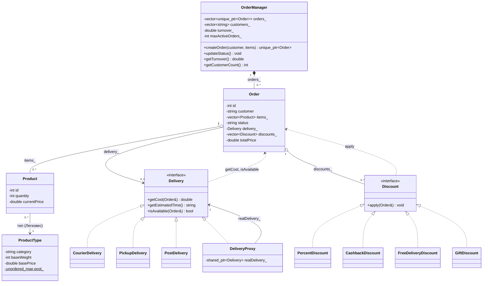

# UML-диаграмма архитектуры системы заказов и доставки

## Диаграмма классов

## Описание связей

| Связь | Тип | Описание |
|---|---|---|
| `OrderManager` → `Order` | композиция | менеджер владеет заказами (`orders_`) и отвечает за их создание |
| `Order` → `Product` | агрегация | заказ содержит список товаров (`items_`) |
| `Product` → `ProductType` | ассоциация | много товаров одной категории ссылаются на один общий объект типа из статического пула (паттерн «Легковес») |
| `Order` → `Delivery` | ассоциация | у заказа один выбранный способ доставки (`delivery_`) |
| `Order` → `Discount` | агрегация | к заказу применяется список акций (`discounts_`) |
| `CourierDelivery`, `PickupDelivery`, `PostDelivery` → `Delivery` | реализация | конкретные способы доставки (паттерн «Стратегия») |
| `DeliveryProxy` → `Delivery` | реализация | заместитель сам является `Delivery` |
| `DeliveryProxy` → `Delivery` | ассоциация | заместитель хранит реальный способ доставки (`realDelivery_`) и делегирует ему вызовы (паттерн «Прокси») |
| `PercentDiscount`, `CashbackDiscount`, `FreeDeliveryDiscount`, `GiftDiscount` → `Discount` | реализация | конкретные акции (паттерн «Стратегия») |
| `Delivery` → `Order`, `Discount` → `Order` | зависимость | методы принимают заказ как параметр (`getCost`, `isAvailable`, `apply`) |

## Перегруженные операторы

Операторы объявлены как свободные функции вне классов и работают с `Order`:

- `Order& operator+(Order&, const Discount&)` — применить акцию к заказу;
- `Order& operator<<(Delivery&, Order&)` — назначить заказу способ доставки.
